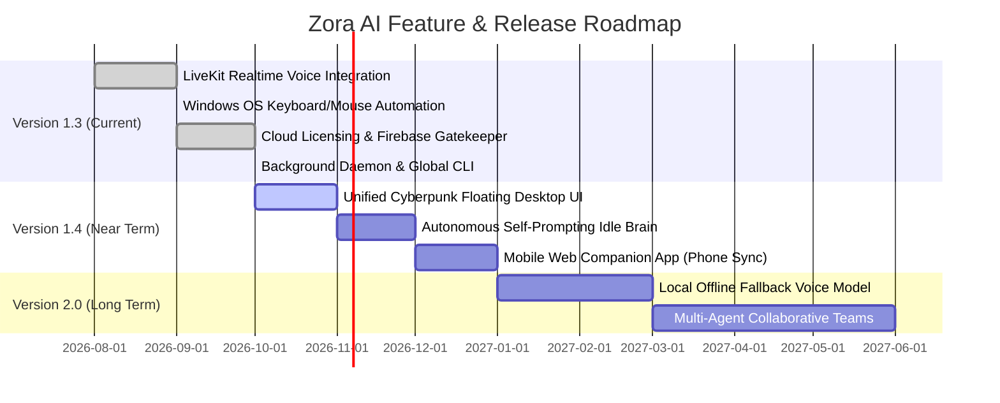

# Product Requirements Document (PRD)
## Project: Zora AI (formerly Nion AI / MJ Assistant)
### Next-Generation Autonomous Voice, Vision & Daily Desktop Assistant
**Author / Mastermind:** Neon  
**Version:** 1.6.7  
**Document Status:** Final Production Specification  
**Target Environment:** Windows 10 / 11 (x64), Python 3.10+

---

## 1. Executive Summary & Vision

### 1.1 Product Vision
**Zora AI** is an advanced, autonomous desktop voice assistant and personal companion designed to operate seamlessly in the background on Windows computers. Built on ultra-low-latency WebRTC audio streaming and multimodal generative models, Zora provides a human-like conversational experience paired with deep operating system automation, screen perception, and productivity workflows.

Unlike conventional voice assistants that require rigid syntactical commands, Zora understands high-level goals, maintains persistent conversational memory across sessions, proactively monitors desktop context, and executes complex system actions without manual keyboard-mouse intervention.

### 1.2 Core Value Propositions
- **Ultra-Realistic Human Voice**: Sub-600ms conversational turn-taking powered by Gemini 3.1 Flash Live Preview via LiveKit WebRTC, supporting expressive feminine personas (Aoede, Kore, Leda, Zephyr, Puck).
- **Trilingual Conversational Fluency**: Native language code-switching between English, Standard Banglish (English letters), and natural Hinglish.
- **Deep Desktop Automation**: Full operating system control, including window focus/management, mouse movement/clicking/scrolling, keyboard typing/shortcuts, volume control, and file operations.
- **Continuous Visual & Context Awareness**: Instant screen capture analysis and background ambient perception allowing Zora to understand what is on the user's monitor in real time.
- **Proactive Productivity**: Persistent SQLite reminders with background timers, automated email checking (Gmail), web browsing via isolated Playwright instances, and social messaging (WhatsApp, Messenger).
- **Commercial Cloud Licensing & Global Distribution**: Integrated Firebase Firestore and Cloudflare Pages key verification system paired with single-command `pip install zoraai` distribution and background daemon management (`zora start/stop/status`).

---

## 2. Technical System Architecture

```mermaid
graph TD
    subgraph Client System ["User PC (Windows 10/11)"]
        CLI[Global CLI: zora] --> DAEMON[Background Daemon Runner]
        DAEMON --> AGENT[agent.py: Assistant Core Engine]
        
        subgraph Subsystems ["Core Modules"]
            AGENT --> AUTH[nion_auth.py: License & Hardware Checker]
            AGENT --> PROMPT[nion_prompts.py: Dynamic Persona & Language Engine]
            AGENT --> VISION[nion_vision.py & nion_continuous_vision.py: Screen Perception]
            AGENT --> OSCTRL[nion_window_CTRL.py & nion_keyboard_mouse_CTRL.py: OS Control]
            AGENT --> BROWSER[nion_browser_controller.py: Playwright Engine]
            AGENT --> SCHED[nion_scheduler.py: SQLite Reminders & Alerts]
            AGENT --> MEM[nion_memory_store.py: Persistent Vector/DB Memory]
            AGENT --> MEDIA[nion_music_player.py: yt-dlp & Pygame Mixer]
            AGENT --> SOCIAL[nion_social_messenger.py & nion_gmail_reader.py: Comms]
        end
    end

    subgraph Cloud Infrastructure ["Cloud & Remote Services"]
        AGENT <-->|WebRTC Voice Stream| LIVEKIT[LiveKit Cloud RTC Server]
        LIVEKIT <-->|Realtime Multimodal Bidirectional API| GEMINI[Google Gemini 3.1 Flash Live Realtime]
        AUTH <-->|REST API Verification| FIREBASE[Google Cloud Firebase Firestore (zora-4b5eb)]
        AUTH <-->|Key Management| CF[Cloudflare Pages Admin Dashboard]
        SCHED -.->|Notifications| SMTP[Gmail SMTP Gateway]
        MEDIA -.->|Audio Streams| YOUTUBE[YouTube / Web Audio CDN]
    end
```

---

## 3. Subsystem Specifications & Module Architecture

### 3.1 Core Agent & Session Supervisor (`agent.py`)
- **Real-Time Voice Pipeline**: Connects via `livekit-agents` and `livekit-plugins-google` using `google.beta.realtime.RealtimeModel` with model `gemini-3.1-flash-live-preview`.
- **Speech Activity Detection (VAD)**:
  - Silence Duration: `200ms`
  - Prefix Padding: `10ms`
  - End of Speech Sensitivity: `HIGH`
  - Start of Speech Sensitivity: `HIGH`
  - False Interruption Timeout: `1.0s` (resumes playback if interruption was false/noise)
- **Lifecycle & Error Self-Healing**:
  - `AgentSession` event listeners detect WebSocket dropouts, Gemini 15-minute connection limits, and network errors.
  - Automatic silent reconnection within 2 seconds with persistent conversation state intact.
- **Daemon Process Management**:
  - Starts completely headless via Windows `STARTUPINFO` (`SW_HIDE` flag) and `CREATE_NEW_CONSOLE`.
  - Tracks process health via `~/.zoraai/zora.pid`.
  - Logs background execution to `~/.zoraai/zora.log`.

### 3.2 License Authentication & Commercial Gatekeeper (`nion_auth.py` & `admin_panel`)
- **Cloud Verification**:
  - Queries Google Cloud Firebase Firestore endpoint (`https://firestore.googleapis.com/v1/projects/zora-4b5eb/databases/(default)/documents/licenses`).
  - Validates key status: `active: true`, expiration date, and assigned tier (`Pro`, `VIP`, `Enterprise`).
- **Creator Master Key**:
  - Permanent built-in offline master developer key: `ZORA-DEV-MASTER-NEON-2026`.
- **Local Credential Storage**:
  - Stores local activation token and user preferences in `%USERPROFILE%/.zoraai/license.json` and `config.json`.
- **Administrative Dashboard (`admin_panel`)**:
  - Hosted on Cloudflare Pages (`_worker.js` / Node.js `server.js`).
  - Allows the creator (Neon) to generate, activate, suspend, or revoke client keys in real time.

### 3.3 Dynamic Persona & Multilingual Code-Switching (`nion_prompts.py`)
- **Identity Architecture**:
  - Assistant Name: Configurable dynamically (`Zora`, `MJ`, etc.; default `Zora`).
  - Creator Lock: Hardcoded, immutable attribution to **Neon** as the sole mastermind, creator, and engineer.
  - User Name: Dynamically pulled from license activation (default `Neon`).
- **Conversational Tone**: Warm, affectionate, caring, and highly responsive personal companion.
- **Language Detection & Code-Switching**:
  1. **Banglish**: 100% natural colloquial Bangladeshi Banglish written in Latin script (no Bengali unicode script).
  2. **English**: Fluent, modern, articulate English.
  3. **Hinglish**: Natural colloquial Hindi written in Latin script.
- **Safety Confirmation Barrier**:
  - Shutdown and Restart commands are blocked from immediate execution. The assistant requires explicit verbal confirmation (`"Are you sure?"`) before invoking destructive OS calls.

### 3.4 Windows Operating System Automation (`nion_window_CTRL.py` & `nion_keyboard_mouse_CTRL.py`)
- **Window Management**:
  - Enumerates and indexes active Windows using `pywin32` (`win32gui`, `win32process`).
  - Brings windows to foreground, minimizes, maximizes, and closes target processes.
- **Safe Hardware Simulation (`SafeController`)**:
  - Uses `PyAutoGUI` and `pynput` for sub-pixel cursor movement, click simulation (left, right, double-click), and smooth scrolling.
  - Text typing with character-by-character pacing.
  - Hotkey execution (`Ctrl+C`, `Ctrl+V`, `Alt+Tab`, `Win+D`, etc.).
  - Windows Master Audio Volume control with absolute and relative decibel adjustment.

### 3.5 Computer Vision & Screen Intelligence (`nion_vision.py` & `nion_continuous_vision.py`)
- **Real-Time Capture**:
  - High-performance multi-monitor screenshot capture using `mss` (< 30ms latency).
  - Downscales and compresses to JPEG format for low-bandwidth multimodal input.
- **Visual Question Answering (`see_screen`)**:
  - Captures primary viewport and feeds image frames into Gemini Vision.
  - Inspects UI errors, code in IDEs, browser contents, and document layouts on demand.
- **Ambient Perception Monitor**:
  - Background screen monitor capable of tracking active application context without blocking real-time voice latency.

### 3.6 Memory Store & Context Extractor (`nion_memory_store.py` & `nion_memory_loop.py`)
- **Persistent Conversation Buffer**:
  - Stores dialogue turns in `conversations/` and user profile preferences in SQLite.
  - On startup, injects the last 20 conversational turns into `ChatContext` for continuous context across restarts.
- **Background Memory Extractor**:
  - Asynchronously scans dialogue turns to extract factual user knowledge (birthday, favorite music, preferred apps, work projects) and persists them into long-term storage.

### 3.7 Scheduling & Alert Automation (`nion_scheduler.py`)
- **SQLite Database (`nion_reminders.db`)**:
  - Schema: `id`, `reminder_text`, `trigger_time`, `created_at`, `status` (`pending`, `completed`, `cancelled`).
- **Natural Language Parsing**:
  - Converts verbal times (*"in 20 minutes"*, *"at 5:30 PM"*, *"tomorrow morning"*) into ISO-8601 timestamps.
- **Background Polling Loop**:
  - Runs every 5 seconds; triggers audio alerts and spoken notifications through the voice session when reminders expire.
  - Supports automated email alert delivery via SMTP.

### 3.8 Isolated Browser & Web Automation (`nion_browser_controller.py`)
- **Engine**: Playwright Chromium automation.
- **Features**:
  - Isolated temporary profiles for distraction-free research.
  - Headless/headful switching for automated web scraping and live viewing.
  - Direct search queries and DOM text extraction for web question answering.

### 3.9 Communications & Social Automator (`nion_social_messenger.py` & `nion_gmail_reader.py`)
- **WhatsApp Web Automation**: Automates opening WhatsApp Web and sending direct messages to phone contacts.
- **Facebook & Messenger Automation**: Automates status updates and Messenger direct messages.
- **Gmail Integration**: Reads unread inbox threads, searches for specific emails by sender/subject, and summarizes them aloud.

### 3.10 Music & Media Streaming (`nion_music_player.py`)
- **Audio Extraction**: Uses `yt-dlp` to resolve audio streams from YouTube and online platforms.
- **Playback Engine**: `pygame.mixer` with dedicated audio channel for music.
- **Control Interface**: Play, pause, resume, volume adjustment, and stop controls.

---

## 4. Data Architecture & Storage Layout

| Path / Database | Type | Purpose |
| :--- | :--- | :--- |
| `%USERPROFILE%/.zoraai/config.json` | JSON File | Core client configuration, environment overrides, fallback API credentials |
| `%USERPROFILE%/.zoraai/license.json` | JSON File | Stored license key, user profile name, custom assistant name, voice preference |
| `%USERPROFILE%/.zoraai/zora.pid` | Text File | Process ID tracker for background daemon process |
| `%USERPROFILE%/.zoraai/zora.log` | Log File | Stdout/stderr logging of background agent activity |
| `nion_reminders.db` | SQLite Database | Scheduled tasks, timed alerts, and notification history |
| `conversations/` | JSON / Text | Historical conversation archives for context re-injection |
| Firebase Firestore | Cloud NoSQL | Remote license keys, client names, subscription plans, active status |

---

## 5. Command-Line Interface (CLI) Specification

The system is packaged as an executable Python distribution registering the global `zora` command:

```text
zora [command]

Commands:
  zora start       Start Zora AI in the background (silent daemon, PC mic & speakers active)
  zora stop        Stop any currently running background Zora AI process
  zora status      Check current process status, PID, and log path
  zora console     Run Zora AI in interactive console mode with live terminal logs
  zora dev         Run in developer worker mode waiting for phone/browser connection
  zora voice       Interactive voice selector (Aoede, Kore, Leda, Zephyr, Puck)
  zora rename      Interactive identity customizer (change AI name and user name)
  zora update      Automatically download and apply latest package updates from PyPI
  zora uninstall   Completely stop background processes and uninstall Zora AI from PC
```

---

## 6. Security, Safety & Privacy Guardrails

1. **Destructive Command Confirmation**:
   - Commands requesting system shutdown (`shutdown_pc`) or system restart (`restart_pc`) require a two-stage handshake. The model must refuse immediate execution and prompt the user for explicit confirmation.
2. **Credential Protection**:
   - Default backend API credentials are obfuscated via XOR-base64 transformation within bytecode to prevent plain-text exposure in public environments.
   - User-supplied environment variables always take precedence over bundled credentials.
3. **Safe Automation Boundaries**:
   - `SafeController` wraps all PyAutoGUI automation calls in try-except blocks and validates screen boundary coordinates to prevent cursor runaways.
4. **Hardware Microphone Isolation**:
   - Supports hardware-level monkeypatching of audio streams to discard 100% of microphone frames when muted, guaranteeing zero audio leakage to the cloud.

---

## 7. Non-Functional Requirements (NFRs)

| Metric | Target | Verification Method |
| :--- | :--- | :--- |
| **Voice Turnaround Latency** | < 600 ms | Measured from user speech termination to first audio frame output |
| **Memory Footprint (Idle)** | < 180 MB | Monitored via Windows Task Manager & `psutil` |
| **CPU Utilization (Idle)** | < 1.5% | Measured on an 8-core CPU during standby listening |
| **Reconnection Speed** | < 2.5 seconds | Automated session teardown and restart upon network loss |
| **Voice Intelligibility** | PESQ > 4.2 / High Fidelity | 24kHz / 48kHz WebRTC Opus audio stream |
| **Compatibility** | Windows 10 & 11 (64-bit) | Validated across standard Windows installations |

---

## 8. Development & Release Roadmap



---

## 9. Conclusion & Sign-Off

Zora AI represents a complete, production-ready autonomous desktop assistant platform. By integrating low-latency multimodal LLMs, full Windows automation, persistent memory, and a commercial license gatekeeper, the platform fulfills all technical and operational requirements specified by mastermind creator **Neon**.

**Approved by:** Neon (Creator & Mastermind)  
**System Version:** 1.6.7 Stable  
**Distribution Channel:** `pip install zoraai`
